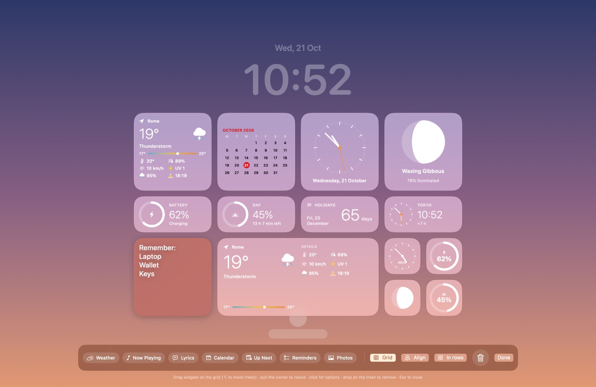
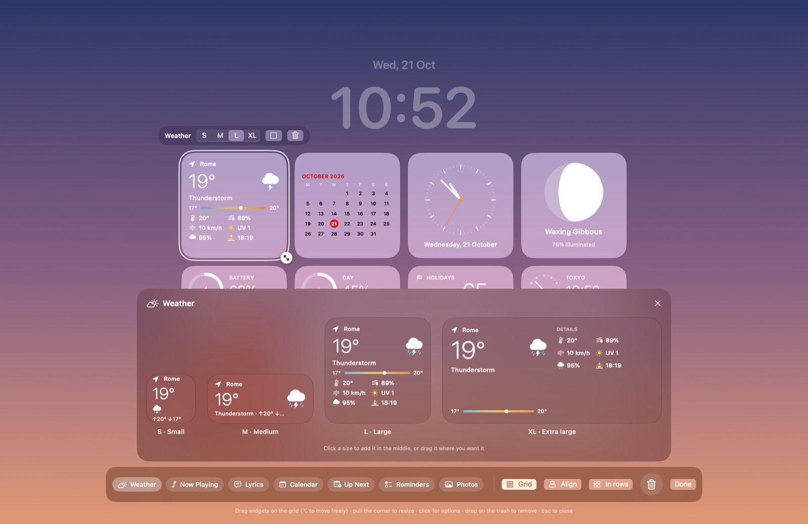

# Bacheca · Mac lock screen widgets

Bacheca puts customizable widgets (weather, music with synced lyrics, calendar, reminders, photos, notes and more) on the Mac lock screen. You arrange them freely in a full-screen studio, like iPhone widgets. Requires macOS 15 or later.



Every widget comes in four sizes; click one in the bar to see them all live before adding it:



The app follows the system language: Italian on Macs set to Italian, English everywhere else. Dates, the first day of the week and permission prompts follow the system too.

The `prototype/` folder holds the first web prototype of the lock screen, to open in a browser.

## Build and run

```bash
./build.sh
open build/Bacheca.app
```

The app lives in the menu bar (padlock icon). From there open **Settings…** or **Arrange Widgets…**.

**Arrange Widgets** opens a full-screen studio over your wallpaper, with a mock clock and login to help you place things:
- drag widgets on the grid: they snap from cell to cell, so edges and spacing always line up. The grid is centered with an even number of columns, so groups come out symmetric; a dashed yellow line marks the middle;
- hold ⌥ (Option) while dragging to place a widget freely; **Grid** turns snapping off;
- **Align** moves every widget to its nearest grid cell; **In rows** lines them up in rows under the clock;
- pull the handle in a widget's bottom-right corner to resize it: it snaps to the nearest of S, M, L and XL;
- click a widget to pick its size (S · M · L · XL), remove its card, pick a color (sticky note) or delete it;
- click a widget in the bottom bar to open the gallery with a live preview in all four sizes; click the one you want or drag it onto the screen;
- drop a widget on the trash to remove it; Esc or **Done** closes the studio.

To try it for real, lock the Mac with ⌃⌘Q: the widgets appear over the lock screen and go away when you log in.

## Widgets

Like iPhone widgets, every widget comes in four sizes, each with its own layout: **S** small (square), **M** medium (rectangle), **L** large (big square), **XL** extra large.

| Widget | What changes with size | Data |
| --- | --- | --- |
| Weather | S temperature · M + conditions · L + details (feels like, humidity, wind, UV, rain, sunrise/sunset) · XL everything in two columns | Open-Meteo, city of your choice |
| Now Playing | S full-bleed artwork · M/XL artwork + track + progress · L large artwork on top | Music and Spotify |
| Lyrics | S current line · M + next · XL three lines · L six lines | [LRCLIB](https://lrclib.net), position from Music or Spotify |
| Calendar | S day · M day + week · L month · XL day, event and month | Calendar |
| Up Next | S the next one · M one · L three · XL three in two columns | Calendar (asks for permission) |
| Reminders | S how many are left · M two · L six · XL eight in two columns | Reminders (asks for permission) |
| Photos | fills the card | folder of your choice, changes every 1–60 minutes |
| Sticky Note | larger text in bigger sizes | your text and color |
| Clock, World Clock | S dial · M/XL dial + digital time · L large dial | computed on the Mac |
| Battery, Day | S ring · M ring + text · L large ring · XL + bar | computed on the Mac |
| Moon Phase | S moon · M/XL + name, % and next full moon · L large moon | computed on the Mac |
| Countdown | S days · M/XL name, date and days · L big number | date of your choice |

Up to 16 widgets. Every widget (except notes and photos) can drop its card and sit right on the wallpaper.

Card styles: Glass, Tinted glass, Dark, Light, Solid, Outline, No background. Color, overall size and font (Standard, Rounded, Serif, Mono) are in Settings.

`open build/Bacheca.app --args --preview` opens the studio straight away, handy while developing (`--gallery` and `--grid` also open the size gallery and show the grid; `--demo` uses a neutral gradient instead of your wallpaper, as in the screenshots above).

## How it works

- The widget window is moved into a private WindowServer "space" above the lock screen, using undocumented SkyLight APIs (technique from [SkyLightWindow](https://github.com/Lakr233/SkyLightWindow), MIT license). They may stop working after a macOS update: Settings then says so, and the studio keeps working.
- That space sits at absolute level 350: above the lock screen (300) but below lock-screen overlays at 400, such as other apps built on SkyLightWindow (for example a Face ID style unlock prompt), so their windows stay in front of the widgets. To put the widgets above them instead: `defaults write local.bacheca.lockwidgets skyLightLevel -int 400`.
- The lock screen window takes no clicks or keystrokes, so it never gets in the way of the password field.
- A check every 2 seconds hides the widgets if the Mac turns out to be unlocked, even if the unlock notification is missed.
- The app is ad-hoc signed: it runs on this Mac and isn't ready for distribution.

## Files

- `SkyLight.swift`: the space above the lock screen
- `AppDelegate.swift`: menu bar, lock/unlock events, windows
- `Widgets.swift`: widget layouts and drawing
- `Studio.swift`: the studio with grid, widget bar, options for the selected widget, trash
- `Services.swift`: weather, music, lyrics, battery, calendar, photos
- `SettingsView.swift`: the Settings window
- `Config.swift`: model, grid and saved preferences
- `L10n.swift`: Italian or English, following the system

## License

Bacheca is released under the [MIT](LICENSE) license. Code adapted from SkyLightWindow and the services it uses (Open-Meteo, LRCLIB) are listed in [THIRD_PARTY_NOTICES.md](THIRD_PARTY_NOTICES.md).
